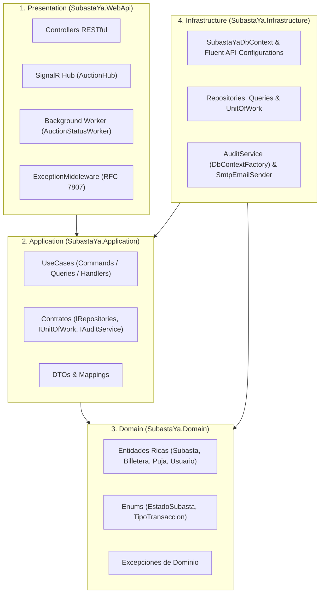
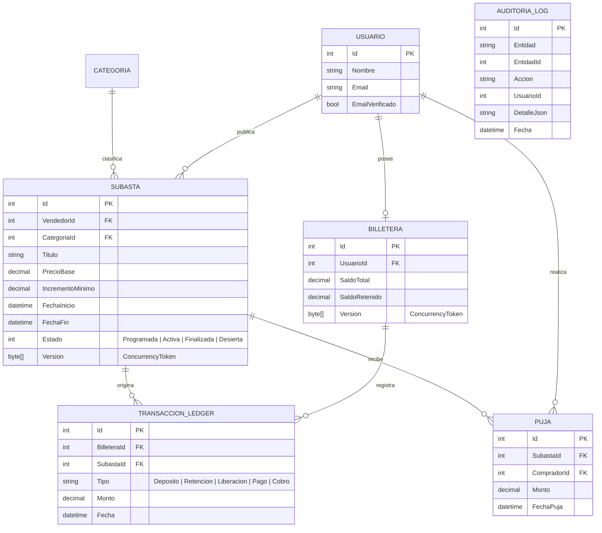

# SubastaYa — Plataforma de Subastas en Tiempo Real


**SubastaYa** es una plataforma web full-stack de subastas electrónicas en tiempo real construida con **ASP.NET Core 8**, **Entity Framework Core 8 (Code-First)**, **SignalR**, **MySQL 8** y una **SPA en JavaScript Vanilla**, diseñada bajo **Clean Architecture (4 capas)** y el patrón **CQRS**.

---

## Aspectos Técnicos Destacados

1. **Garantía Financiera Atómica (Escrow en Billetera Virtual):**
   Toda oferta está respaldada por saldo real. Al registrar una puja superadora, el sistema **libera automáticamente el saldo retenido del líder anterior y bloquea el saldo del nuevo postor** dentro de una misma transacción ACID, dejando trazabilidad contable inmutable en el libro mayor (`TransaccionLedger`).
2. **Regla Anti-Sniping en Tiempo Real:**
   Si entra una puja válida dentro de los **últimos 60 segundos** antes del cierre, la subasta **extiende automáticamente su finalización por 2 minutos adicionales** y notifica instantáneamente a todos los participantes conectados a la sala mediante **WebSockets (SignalR)**.
3. **Control de Concurrencia Optimista (`RowVersion` / HTTP 409):**
   Las entidades críticas (`Subasta` y `Billetera`) implementan tokens de concurrencia optimista. Ante dos ofertas simultáneas en el mismo milisegundo, la base de datos confirma únicamente la primera (`201 Created`) y rechaza la colisión con `409 Conflict` (`ProblemDetails` RFC 7807).
4. **Liquidación Automática en Segundo Plano (`BackgroundService`):**
   El worker [`AuctionStatusWorker`](Backend/src/SubastaYa.WebApi/Workers/AuctionStatusWorker.cs) monitorea periódicamente las subastas: activa las programadas cuando llega su fecha de inicio, adjudica las vencidas transfiriendo los fondos retenidos al vendedor (`Finalizada`) o las declara `Desierta` si no recibieron ofertas.
5. **Auditoría Inmutable en Transacción Independiente (`IDbContextFactory`):**
   Los eventos críticos —incluyendo pujas rechazadas por saldo insuficiente, subasta vencida, autopuja o colisión de concurrencia— se persisten en `AuditoriaLog` mediante un `DbContext` efímero e independiente para que el registro de auditoría sobreviva al `Rollback` de la transacción principal.

---

## Arquitectura del Sistema (Clean Architecture + CQRS)

La solución está dividida en **4 capas desacopladas** siguiendo el Principio de Inversión de Dependencias (DIP):



### Estructura de Proyectos

```text
├── Backend/src/
│   ├── SubastaYa.Domain/           # Entidades con comportamiento (Rich Domain Model), Enums y Excepciones
│   ├── SubastaYa.Application/      # Casos de uso CQRS (Commands, Queries, Handlers), Interfaces, DTOs y Mappings
│   ├── SubastaYa.Infrastructure/   # EF Core 8, Fluent API Configurations, Migraciones, Repositorios y Servicios
│   ├── SubastaYa.WebApi/           # Controladores REST, SignalR Hub, Background Worker, JWT y ExceptionMiddleware
│   └── SubastaYa.UnitTests/        # Tests unitarios con xUnit y NSubstitute
├── Fronted/SubastaYa-Fronted/      # Single Page Application (HTML5, CSS3, JS ES6+ y cliente SignalR)
├── docker-compose.yml              # Orquestación de API + MySQL 8 + Mailpit (SMTP)
└── stress-test.sh / .ps1           # Scripts de prueba de estrés y concurrencia optimista (HTTP 409)
```

---

## Modelo de Datos (DER)



---

## Endpoints Principales de la API REST (`v1`)

| Método | Ruta | Descripción | Auth |
| :--- | :--- | :--- | :---: |
| `POST` | `/api/v1/auth/tokens` | Autenticación de usuario y emisión de token JWT | No |
| `POST` | `/api/v1/users` | Registro de nuevo usuario con verificación por email | No |
| `GET` | `/api/v1/auctions` | Catálogo de subastas con filtros (estado, categoría, precio, orden) | No |
| `GET` | `/api/v1/auctions/{id}` | Detalle de subasta en vivo, oferta actual e historial de pujas | No |
| `POST` | `/api/v1/auctions` | Publicación de una nueva subasta | JWT |
| `POST` | `/api/v1/auctions/{auctionId}/bids` | Registro de puja (valida saldo, aplica Escrow y Anti-Sniping) | JWT |
| `GET` | `/api/v1/wallets/balance` | Consulta de Saldo Total, Retenido en Garantía y Disponible | JWT |
| `GET` | `/api/v1/wallets/transactions` | Historial de movimientos contables en el Ledger | JWT |
| `POST` | `/api/v1/wallets/deposits` | Carga simulada de saldo en la billetera virtual | JWT |
| `GET` | `/api/v1/users/auctions` | Panel del vendedor: mis subastas publicadas | JWT |
| `GET` | `/api/v1/users/bids` | Panel del comprador: subastas en las que participé | JWT |

---

## Ejecución Rápida con Docker Compose (Recomendado)

El repositorio incluye un entorno contenerizado que levanta **MySQL 8**, **Mailpit** (servidor SMTP con bandeja web) y la **Web API + Frontend SPA**, aplicando automáticamente las migraciones y cargando los datos semilla (`DbInitializer`).

### 1. Levantar todos los servicios
```bash
docker compose up --build
```

### 2. Accesos directos
* **Aplicación Web (Frontend SPA):** [http://localhost:5000/index.html](http://localhost:5000/index.html)
* **Documentación Interactiva (Swagger UI):** [http://localhost:5000/swagger](http://localhost:5000/swagger)
* **Bandeja de Correos (Mailpit Web UI):** [http://localhost:8025](http://localhost:8025)
* **Hub WebSockets (SignalR):** `http://localhost:5000/hubs/auction`

### 3. Usuarios de Prueba Precargados (Seed Data)

| Rol / Escenario | Email | Contraseña | Saldo Total | Saldo Retenido | Saldo Disponible |
| :--- | :--- | :--- | :---: | :---: | :---: |
| **Vendedor** | `vendedor@test.com` | `123456` | $0 | $0 | $0 |
| **Comprador 1 (Líder)** | `comprador1@test.com` | `123456` | $150.000 | $45.000 | $105.000 |
| **Comprador 2** | `comprador2@test.com` | `123456` | $200.000 | $18.000 | $182.000 |
| **Sin Fondos** | `sinfondos@test.com` | `123456` | $500 | $0 | $500 |

### 4. Detener el entorno
```bash
docker compose down
```
*(Para reiniciar la base de datos desde cero eliminando el volumen: `docker compose down -v`).*

---

## Ejecución Local y Tests Unitarios (Sin Docker)

### Compilar la solución
```bash
dotnet build Backend/src/SubastaYa.WebApi/SubastaYa.WebApi.csproj
```

### Ejecutar los Tests Unitarios (xUnit + NSubstitute)
```bash
dotnet test Backend/src/SubastaYa.UnitTests/SubastaYa.UnitTests.csproj
```

### Aplicar Migraciones y Ejecutar la API
```bash
dotnet ef database update --project Backend/src/SubastaYa.Infrastructure --startup-project Backend/src/SubastaYa.WebApi
dotnet run --project Backend/src/SubastaYa.WebApi/SubastaYa.WebApi.csproj
```

---

## Prueba de Estrés y Concurrencia Optimista (Stress Test)

Para demostrar que dos ofertas simultáneas por el mismo monto no corrompen los saldos ni duplican la puja ganadora, el repositorio incluye scripts de estrés en **PowerShell** ([`stress-test.ps1`](stress-test.ps1)) y **Bash** ([`stress-test.sh`](stress-test.sh)).

```powershell
# En Windows PowerShell:
./stress-test.ps1
```
```bash
# En Linux / macOS / Git Bash:
./stress-test.sh
```

### Resultado del Test de Concurrencia
El script dispara dos peticiones `POST /api/v1/auctions/{id}/bids` en paralelo en el mismo milisegundo:
1. **Petición 1 (Ganadora):** Retiene el saldo en garantía, actualiza la versión de la fila y devuelve **`HTTP 201 Created`**.
2. **Petición 2 (Colisión):** Detecta el cambio de estado/versión, hace rollback, audita el conflicto en `AuditoriaLog` y devuelve **`HTTP 409 Conflict`**:
   ```json
   {
     "type": "https://tools.ietf.org/html/rfc9110#section-15.5.10",
     "title": "Conflicto de concurrencia",
     "status": 409,
     "detail": "La subasta fue modificada por otro usuario. Por favor intente nuevamente."
   }
   ```
